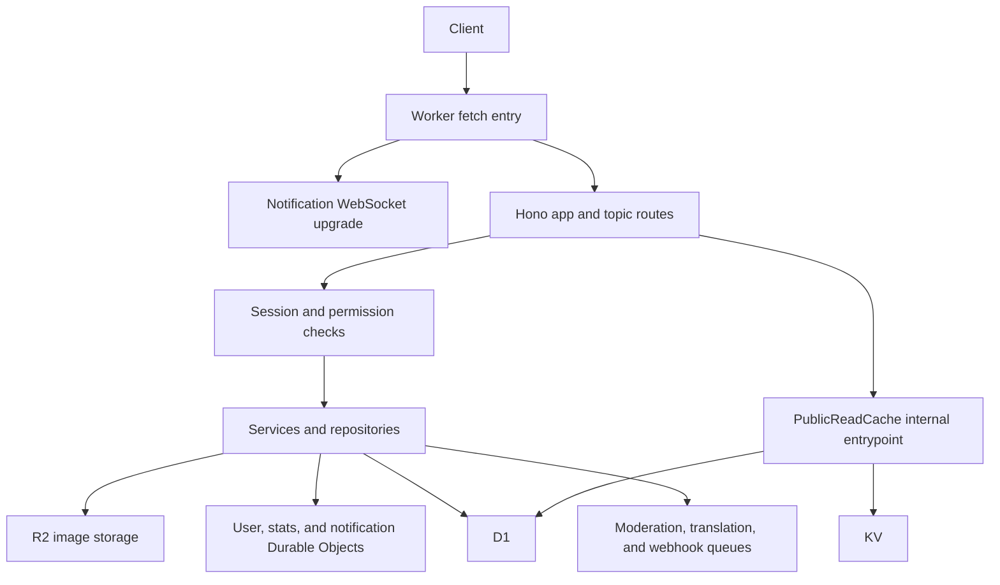

# Architecture

Bayes runs as a Cloudflare Worker with HTTP, scheduled, queue, and internal cache
entrypoints. [`src/index.ts`](../src/index.ts) exports them and the Durable Object
classes; [`wrangler.toml`](../wrangler.toml) declares their bindings.

## Request flow

The notification upgrade is handled before Hono so the raw upgrade response is
preserved. Ordinary requests enter `src/app.ts`, which installs request IDs, CORS,
and error handling, then mounts the topic routers through `src/routes/route.ts`.
Locator streams have their own upgrade handler in the locator route module.

## Module ownership

See [the repository layout](../README.md#repository-layout) for source locations
and [coding standards](../CODING_STANDARDS.md) for responsibility boundaries.
Some boundaries are partially adopted: progress repositories still live under
`services/progress/`, and some handlers contain SQL or business orchestration.

## Accounts and identity

Better Auth stores accounts, sessions, and verifications in D1. The public auth
router explicitly registers supported operations; it does not expose every
Better Auth endpoint. The auth instance is scoped to the Worker request.

Authentication middleware resolves the session and the OEM user profile.
Business roles and karma belong to that profile. Public user identifiers and
internal user IDs serve different purposes; use the identifier required by the
specific schema. Browser cookies and the OAuth exchange flow are described in
[the API guide](api.md#accounts).

## Progress and statistics

`OEM_USER_DO`, selected by internal user ID, coordinates marker and archive
progress requests. State is persisted in D1. A manifest identifies the ordered
point or archive index; bitmap storage is an internal representation, while the
public state response exposes IDs and a revision.

Marker sync uses mutation IDs and a D1 outbox to deliver statistics deltas to
`OEM_STATS_DO`. Scheduled recovery retries undelivered events and cleans up
consistency records. The one-minute cron always schedules progress recovery;
`LOCK_SCHEDULED_JOBS` controls the separate karma/moderation job path.

See [`services/progress/`](../src/services/progress/) for manifests, normalization,
atomic persistence, delivery, and consistency tests.

## Community content and public reads

Image submissions enter as multipart data. The upload service validates and
processes the image, stores the object in R2, creates a pending D1 submission,
and enqueues moderation. Comments use JSON and the shared comment content
contract. Queue consumers process moderation, translation, and webhook work.

Public image/comment reads use the `PublicReadCache` internal entrypoint.
Workers Cache stores per-marker responses; origin loaders use KV and D1.
Missing markers are deduplicated within the invocation and queried in batches
of at most 100. The client reads up to eight marker responses concurrently,
preserves requested order, and applies list limits. Partial results identify
`failedMarkerIds` and use `private, no-store`.

Viewer reactions and private contributions must stay outside shared public
cache values. Mutations invalidate affected content caches. See
[`src/publicRead/README.md`](../src/publicRead/README.md).

Submission status changes retain historical records and stored objects. The
moderation cleanup routes do not provide general hard deletion.

## Live services and external dependencies

- `OEM_NOTIFICATION_DO` publishes account-specific notification updates over WebSockets.
- Locator services use a bound Endfield account, credential refresh, position caching,
  and managed upstream sockets. Timers and listeners are released on close.
- Upstash Redis supports workflows including binding sessions and rate limiting.
  It is not a substitute for D1 progress persistence.
- Email uses the configured Resend/Cloudflare provider policy; social login,
  moderation, and translation require their respective external credentials.
- `OEM_IMG_TRANS` runs the image transcoder container.

## Observability

HTTP requests expose `x-request-id`. Cloudflare observability is configured in
Wrangler; the separate `oem-errogger` Tail Worker records failed invocations in its
own D1 database. A successful health request establishes HTTP reachability only.
See [operations](operations.md) for validation and deployment boundaries.
